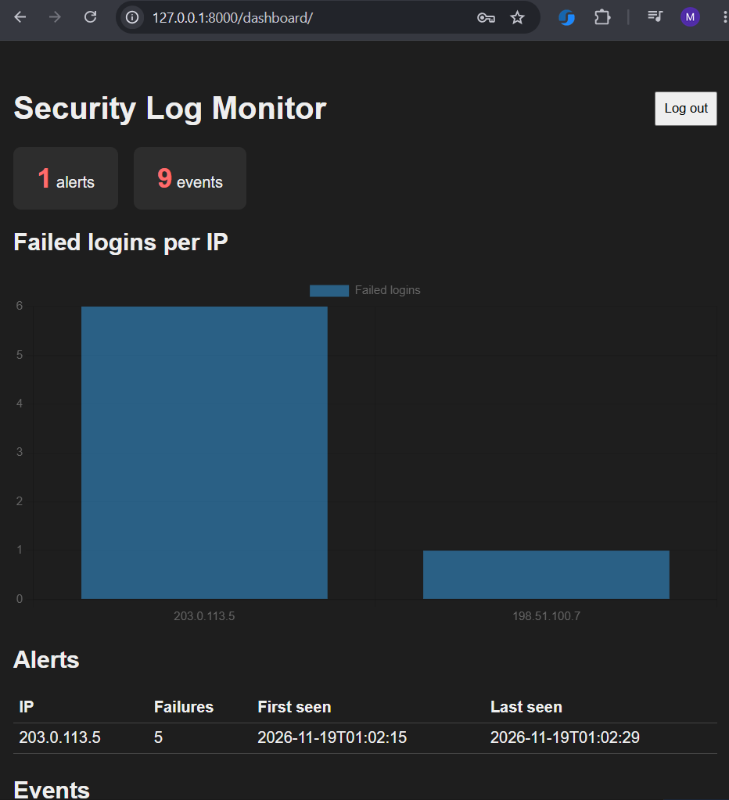
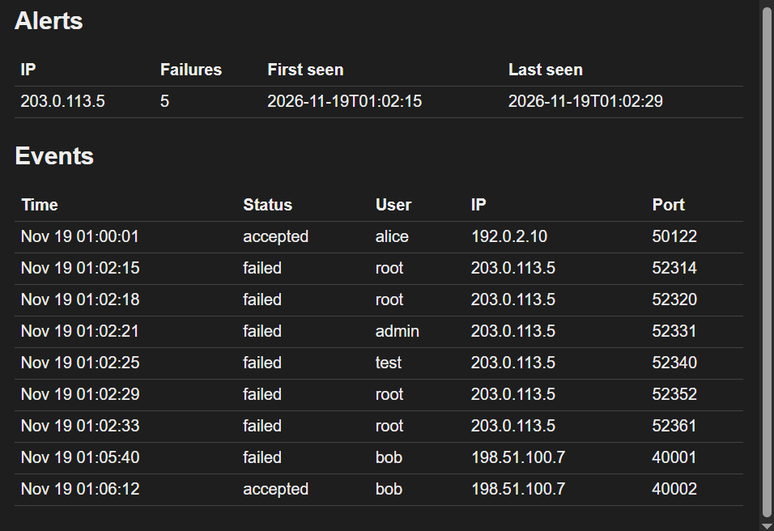
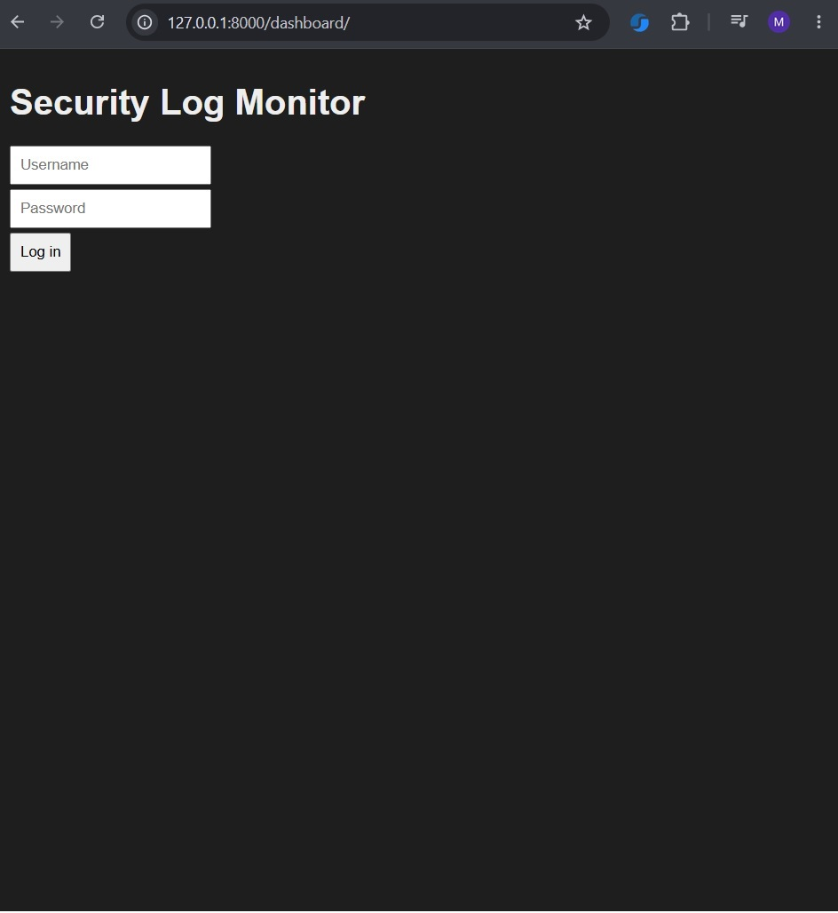

# Security Log Monitor

A small security monitoring web app. It reads SSH login logs, detects brute-force attacks, and shows the alerts on a protected dashboard.




## Features

- Parses SSH `auth.log` lines into structured events with regular expressions
- Detects brute-force attempts: 5 failed logins from the same IP within 60 seconds raises an alert
- Stores events and alerts in a SQL database (SQLite)
- REST API built with FastAPI, with automatic documentation at `/docs`
- Login with Argon2-hashed passwords and JWT tokens
- Web dashboard with alert counters, a chart of failed logins per IP, and event tables

## How it works

```
auth.log --> parser --> detection --> SQLite database --> FastAPI REST API --> dashboard
            (regex)    (sliding window)                  (JWT protected)     (HTML/JS/Chart.js)
```

## Security choices

- **Passwords are never stored**, only Argon2 hashes with a random salt.
- **JWT tokens** expire after 30 minutes; the signing key is kept in a `.env` file that is not committed.
- **SQL injection protection:** every query uses parameterized placeholders (`?`).
- **XSS protection:** log data (attacker-controlled usernames) is inserted with `textContent`, never `innerHTML`.
- The login error message does not reveal whether a username exists.

## Tech stack

Python · FastAPI · Uvicorn · SQLite · PyJWT · pwdlib (Argon2) · HTML · CSS · JavaScript · Chart.js

## Run it locally

```bash
git clone https://github.com/MohamadMoubarak/security-log-monitor.git
cd security-log-monitor
python -m venv .venv
.venv\Scripts\Activate.ps1          # on Linux/macOS: source .venv/bin/activate
python -m pip install -r requirements.txt
```

Create a `.env` file with a secret key:

```bash
python -c "import secrets; print(secrets.token_hex(32))"
# then put this line in .env:  SECRET_KEY=<the generated key>
```

Create a user, load the sample log, and start the server:

```bash
python -m app.create_user
python -m app.ingest
python -m uvicorn app.main:app --reload
```

Open http://127.0.0.1:8000/dashboard/ and log in.

## Screenshots

| Login | API documentation |
|---|---|
|  |  |

## Project structure

```
app/
  parser.py        # reads log lines into events
  detection.py     # brute-force detection rule
  database.py      # SQLite tables and queries
  security.py      # password hashing and JWT tokens
  main.py          # FastAPI routes
  ingest.py        # runs parser + detection and saves results
  create_user.py   # creates a login account
static/            # dashboard (HTML, CSS, JavaScript)
samples/auth.log   # sample log with a simulated attack
```

## Next steps

- Run with Docker
- Automated tests with pytest
- Analyze real logs from a Linux server